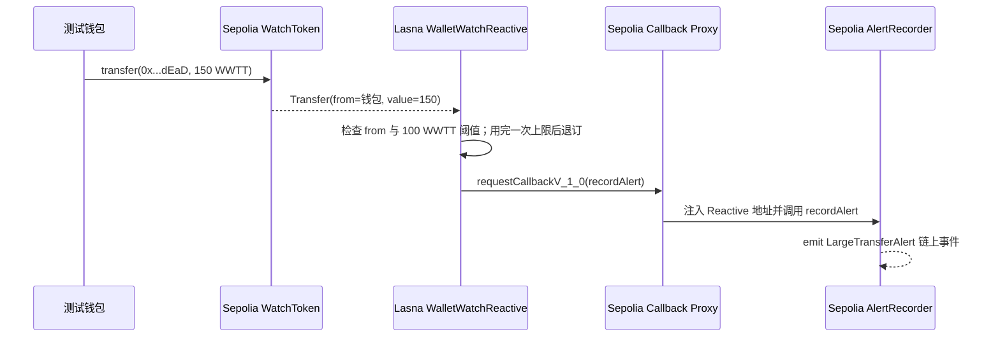

# Reactive Builder Camp｜MIA_Ether 的学习仓库

记录 Reactive Network Omni 版的共学笔记、测试网验证和后续项目实践。当前以 **Ethereum Sepolia → Lasna → Ethereum Sepolia** 的事件驱动自动化为学习路线。

## 学习进度

| 阶段 | 内容 | 状态 |
| --- | --- | --- |
| 第 0 周 | [环境准备：测试钱包、lREACT、Foundry](notes/day-00-environment.md) | Lasna 余额已验证；模板 `forge test` 8/8 通过 |
| D1 · 11/16 | [用例拆解卡：测试钱包大额转账监控](notes/d1-use-case.md) | 方案已写，合约地址待部署后补充 |
| D2 · 11/17 | [用 `cast` 读取 Lasna 费用参数](notes/day-02-lasna-fees.md) | 三个链上参数已实测 |
| D3 · 11/18 | [第一次 Reactive 部署](notes/d3-first-reactive.md) | Lasna 合约与 `react()` 交易已验证 |
| D4 · 11/19 | [跨链回调三步走](notes/d4-cross-chain-callback.md) | Sepolia 事件 → Lasna `react()` → Sepolia Callback 已验证；直接调用失败实验已记录 |
| 第 2 周方向 | [项目方向卡：Wallet Transfer Watch](notes/d5-project-direction.md) | 赛道 2，solo；第一条完整链路已跑通 |
| 场景小实验 | [动态订阅与停止事件](notes/d6-dynamic-subscription.md) | 两次 `react()` 已验证，第二次自动退订 |

## 当前项目设想

监听 Sepolia 上测试 ERC-20 的 `Transfer` 事件；当测试钱包单笔转出达到阈值时，Lasna 上的 Reactive 合约判断并请求回调，让 Sepolia 的记录合约发出告警事件。[项目方向卡](notes/d5-project-direction.md)与下方的链上证据对应。D4 的模板 `Ping` 练习另见[跨链回调笔记](notes/d4-cross-chain-callback.md)。

## Wallet Transfer Watch｜第一条完整链路

这是本仓库自己的项目合约：[WatchToken](src/WatchToken.sol) 提供 Sepolia 测试代币，[WalletWatchReactive](src/WalletWatchReactive.sol) 监控指定钱包的大额转出，[AlertRecorder](src/AlertRecorder.sol) 在 Sepolia 记录经过 Callback Proxy 验证的告警。[本地链路测试](test/WalletWatch.t.sol)已通过。

链上地址：

- [WatchToken · Sepolia](https://sepolia.etherscan.io/address/0x8c8e376E8fE1B7A866a8f29F442d2047df99Bc9E)
- [WalletWatchReactive · Lasna](https://lasna.reactscan.net/address/0xd99b9CAC45C478D24839B40150aC2607b9e327A5)
- [AlertRecorder · Sepolia](https://sepolia.etherscan.io/address/0x806cE576BF65E68Bb8d6479E82fB255218539b8A)

三笔交易，均记录同一个 Sepolia 源交易哈希 `0x1a2b0d1b0bfc84f645b2a00ec3e7b46e1895f907b55e3205967e67c5afd2cdbe`：

1. [源链：Sepolia `Transfer`，转出 150 WWTT](https://sepolia.etherscan.io/tx/0x1a2b0d1b0bfc84f645b2a00ec3e7b46e1895f907b55e3205967e67c5afd2cdbe)
2. [Reactive：Lasna 判断并请求回调](https://lasna.reactscan.net/tx/0x45200ea9a4af6a324eea94e0176c7e7291d823c6e1b2baec1ecfc14b1919df9c)
3. [目标链：Sepolia `LargeTransferAlert`](https://sepolia.etherscan.io/tx/0xeb72216d529ede6bad86c9b33d02bdbb2995cc1e5e4bf33e4448268f3238db65)

此最小 Demo 只使用测试网和测试代币。Reactive 合约的处理上限是 1 次，达到后退订；Callback 端按源交易哈希和日志序号去重。回调成功后 `AlertRecorder.count() = 1`，Reactive 与 Callback Proxy 的 `debt` 均为 0。

### 保护与出问题怎么办

当前源码还检查链、代币、`from` 钱包、`Transfer` topic 和金额阈值；用链 ID、源交易哈希和日志序号识别已处理事件。自动告警只处理 **100–1,000 WWTT**，上限等于这个测试代币的总发行量，异常的大于总量的日志不会触发回调；单次实验最多请求 **1 次**回调，并限制回调 gas 为 500,000。告警合约不持有或转移被监控代币，所以自动资产转移上限是 **0 WWTT**。[保护测试](test/WalletWatch.t.sol)覆盖正常告警、低于阈值、错误钱包、超额金额、重复事件与未授权回调。以上金额上限和 Reactive 侧显式去重属于本次源码更新，**先前已部署的 MVP 合约仍是旧版，不能原地升级**；若要在链上验证新增保护，需重新部署。

Lasna 合约余额不足时，费用可能形成 `debt`；只要欠款大于 0，系统就停止调用 `react()`。通过 Lasna 系统合约 `0x8888888888888888888888888888888888888888` 的 `depositTo(address)` 给该 Reactive 合约充值，可先清欠再恢复未来事件；只把 lREACT 转到合约地址不会自动清欠。目标链 `AlertRecorder` 也要有 Sepolia ETH；若 Callback Proxy 记录了欠款，通过 Sepolia Proxy 的 `depositTo(address)` 清欠。失败的 `react()` 或回调仍收费，失败回调不会自动重试；检查 Reactscan 和 Sepolia 回执中的失败原因，修好后需要重新触发或部署新实例。本 Demo 成功处理一次后会退订，**充值不会重新订阅**；需要继续监控时应部署新实例。

## 参考资料

- [Reactive Contracts](https://dev.reactive.network/reactive-contracts)
- [Callback Contracts](https://dev.reactive.network/callback-contracts)
- [Economy](https://dev.reactive.network/economy)
- [Omni micro-demos](https://github.com/Reactive-Network/reactive-smart-contract-demos/tree/omni/src/micro-demos)

练习仅使用测试网和测试资产。仓库不保存私钥、助记词或钱包签名凭据。
