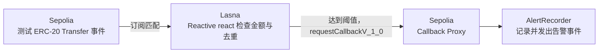

# D1 用例拆解卡：测试钱包大额转账监控

一句话：我想让测试钱包的代币转出超过预设阈值时，自动在链上留一条可核验的告警记录。

## 1. 监听什么？

源链是 **Ethereum Sepolia**。监听我部署的测试 ERC-20 代币合约发出的 `Transfer(address indexed from, address indexed to, uint256 value)` 事件。部署后把该代币地址写进订阅条件；`from` 限定为测试钱包 `0x17cB337e22e6B0F1471a8ff0491198dfF2882913`，避免让无关转账反复触发并产生费用。

## 2. 什么条件触发？

`react()` 收到匹配的转出事件后，解码 `value`，按代币的小数位换算。若单笔转出 **≥ 100 枚测试代币**，且该源链事件尚未处理过，就请求回调；否则正常返回。记录源链交易哈希和日志序号作为去重依据，避免同一事件生成重复告警。

## 3. 在哪条链做什么？

Reactive 合约部署在 **Lasna**。目标链先选 **Ethereum Sepolia**：回调一个 `AlertRecorder` 合约，写入事件标识、转出地址、接收地址和金额，并发出 `LargeTransferAlert` 事件。后续若需要 Telegram 通知，可由链下服务监听该告警事件；链上回调本身只保证记录，不直接发送 Telegram 消息。

## 4. 不用 Reactive 怎么做？收益和代价是什么？

不用 Reactive，我要自己运行 7×24 小时的监听机器人，连接 Sepolia RPC，保存已处理事件和私钥，在达到阈值时主动发交易到记录合约；或者手动盯区块浏览器，容易漏掉事件。Reactive 把事件订阅、触发和跨链回调交给网络，减少自建服务器和维护任务。代价是每次 `react()` 和目标链回调都要付 gas，失败调用也可能收费；需要为两边的合约预留资金，并处理重复事件、回调失败及 `debt > 0` 导致的停机。它不保证抢在攻击交易之前执行，所以这里定位为告警记录，不承诺挽回已转出的资产。

## 落地时要核对

- 用测试专用钱包和测试代币，不处理真实资产。
- 部署后补充测试代币、Reactive 合约和 `AlertRecorder` 的实际地址及链上交易链接。
- `react()` 使用 `onlySystem`；回调请求使用 `requestCallbackV_1_0`；回调接收方验证服务提供者和 Reactive 合约地址。

参考：[Reactive Contracts](https://dev.reactive.network/reactive-contracts)、[Callback Contracts](https://dev.reactive.network/callback-contracts)、[Economy](https://dev.reactive.network/economy)、[Omni micro-demos](https://github.com/Reactive-Network/reactive-smart-contract-demos/tree/omni/src/micro-demos)。
